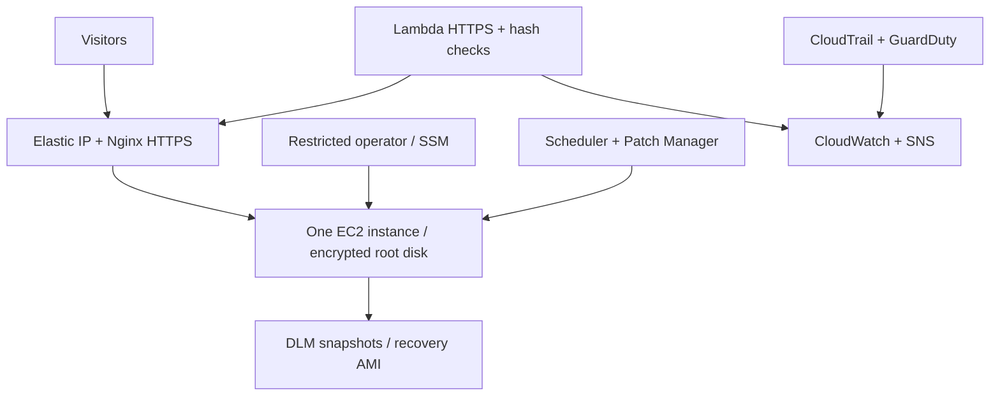

<div align="center">

# EC2 website: from deployment to operating evidence

**Zerah Abba · Amazon Linux 2023 · Terraform · Stockholm**

An HTTPS website with scheduled operating hours, encrypted backups, tested recovery, logged administration and content-aware monitoring.

[**Open the live website**](https://16.192.190.65/) · [Health endpoint](https://16.192.190.65/healthz) · [Technical report](REPORT.pdf) · [Evidence index](#screenshot-evidence)

**07:00–19:00 Africa/Lagos · UTC+1 · Evidence updated 15 November 2026**

</div>

[](https://16.192.190.65/)

**Website after the scheduled morning start.** The landing page loads at the retained public address after the recorded start. EC2 status and CloudTrail supply the infrastructure identity and timing. [Open original](https://drive.google.com/file/d/1zW2y7Y4l5IClYq7wiNDbGp8ZyfOcX_oR/view?usp=drivesdk).

The website runs on one EC2 instance. The surrounding work is what makes the project useful: a reproducible build, restricted daily access, a tested restore path, automated maintenance and evidence that the unattended jobs actually ran.

The live server is intentionally stopped overnight. If the link is unavailable outside operating hours, use the dated captures below. The endpoint may also be retired after the assessment.

## Start with the results

| Question | Recorded result | Evidence |
| --- | --- | --- |
| Does Terraform validate? | `Success! The configuration is valid.` | [Terraform validation succeeds](https://drive.google.com/file/d/1Us6g04hYc8guLcpIpfwwjJKvzbHL3Olt/view?usp=drivesdk) |
| Does the deployed infrastructure match the code? | The plan reports **No changes**. | [Terraform reports no infrastructure changes](https://drive.google.com/file/d/10Mo0RaZPPn7VqEAl1R0jAW3jN6s_J8kB/view?usp=drivesdk) |
| Did the website start automatically? | **15 Nov, 07:00:23 Lagos**; current instance; Scheduler role; no reported error. | [Recorded automatic morning start](https://drive.google.com/file/d/1jXVK2CxZmHjpxbZf5CYLZELwCrFPJKmU/view?usp=drivesdk) |
| Did it stop automatically? | **14 Nov, 19:00:30 Lagos**; current instance; Scheduler role. | [Recorded automatic evening stop](https://drive.google.com/file/d/1LRlEMvmo8KyXT7tvHQTOm_aKMmeDeSv8/view?usp=drivesdk) |
| Did the backup policy create a real snapshot? | Completed, encrypted snapshot of the **current root disk**. | [Completed automatic root-disk snapshot](https://drive.google.com/file/d/1-txEwwlK3AXq38lojiTxhv-kXCXPH7FI/view?usp=drivesdk) |
| Is the server healthy? | System, instance and EBS checks passed. | [System, instance and EBS checks passed](https://drive.google.com/file/d/196neuNiw51MTUNPN5B3Ce3jYjEFWHaYX/view?usp=drivesdk) |
| Did daily patching complete? | Latest Install: **0 missing / 0 failed / 0 pending reboot**. | [Daily patch installation completed](https://drive.google.com/file/d/1XXxL-Mc16_TaIjWt5RdYEU7mrF9YMVdA/view?usp=drivesdk) |
| Did a website failure alert reach the inbox? | The `ec2-test-website-failure` ALARM email is visible. | [Website-content ALARM reached the inbox](https://drive.google.com/file/d/1DfbjOEWQkmAGaXYtSnx2ER8-oIIUEgnk/view?usp=drivesdk) |
| Are the alarms currently clear in the capture? | All **seven** alarm states are `OK`. | [Seven alarm states are OK](https://drive.google.com/file/d/18VhhCCO4bGjiuXUTwmySQIkaEXNM_KVl/view?usp=drivesdk) |
| Can the restricted operator connect? | An `ec2-test-operator` Session Manager shell starts successfully. | [Restricted operator opened an SSM shell](https://drive.google.com/file/d/1t-lefAt_YZZkKnBuoYjqSuZev31WWX8X/view?usp=drivesdk) |

These are dated test and service results. They do not establish continuous availability or guarantee future jobs. The completed automatic snapshot is separate from the manual snapshot used in the earlier restore drills.

## Terraform proof

The validation checks the configuration. The plan then refreshes the deployed resources and reports whether they match it. Both screenshots are included so the reviewer can see the commands and their actual results.

[](https://drive.google.com/file/d/1Us6g04hYc8guLcpIpfwwjJKvzbHL3Olt/view?usp=drivesdk)

**Terraform validation succeeds.** The terminal shows terraform validate -no-color followed by Success! The configuration is valid. [Open original](https://drive.google.com/file/d/1Us6g04hYc8guLcpIpfwwjJKvzbHL3Olt/view?usp=drivesdk).

[](https://drive.google.com/file/d/10Mo0RaZPPn7VqEAl1R0jAW3jN6s_J8kB/view?usp=drivesdk)

**Terraform reports no infrastructure changes.** The plan finishes with No changes. Your infrastructure matches the configuration. This is a capture-time drift result, not a new apply. [Open original](https://drive.google.com/file/d/10Mo0RaZPPn7VqEAl1R0jAW3jN6s_J8kB/view?usp=drivesdk).

## The overnight cycle, recorded by AWS

Both EventBridge Scheduler schedules are enabled, use `Africa/Lagos`, have flexible windows `OFF` and target the current instance. The CloudTrail records identify the automation role rather than a manual laptop action.

| Action | Nigeria time | Event ID |
| --- | --- | --- |
| Stop | 14 November 2026, **19:00:30 +01:00** | `3cc10a9f-c315-4f2f-b34c-c21f319a0d54` |
| Start | 15 November 2026, **07:00:23 +01:00** | `0de9dace-302b-47a1-8a01-e65a1d0c3f9b` |

**Target:** `i-0d341cc5ce8fd20a7`  
**Caller role:** `ec2-test-scheduler-bf5f87ef53e6815ea9b5bed874`

[](https://drive.google.com/file/d/1jXVK2CxZmHjpxbZf5CYLZELwCrFPJKmU/view?usp=drivesdk)

**Recorded automatic morning start.** The event summary records StartInstances at 07:00:23 Lagos on 15 November, for the current instance under the Scheduler role, without a reported error. [Open original](https://drive.google.com/file/d/1jXVK2CxZmHjpxbZf5CYLZELwCrFPJKmU/view?usp=drivesdk).

[](https://drive.google.com/file/d/1LRlEMvmo8KyXT7tvHQTOm_aKMmeDeSv8/view?usp=drivesdk)

**Recorded automatic evening stop.** The terminal summary identifies the current instance, StopInstances, the Scheduler role and 19:00:30 Nigeria time on 14 November. [Open original](https://drive.google.com/file/d/1LRlEMvmo8KyXT7tvHQTOm_aKMmeDeSv8/view?usp=drivesdk).

## A completed backup, not just an enabled policy

The verification script filters by the current root volume and the DLM policy's system tag. It returned the following snapshot:

| Field | Recorded value |
| --- | --- |
| Automatic snapshot | `snap-000f7e5c9f820db42` |
| Root volume | `vol-0331a7c76186f6e18` |
| State | `completed` |
| Encryption | `true` |
| Started | 14 November, **21:26:47 Lagos** / 20:26:47 UTC |
| Policy | Daily EBS snapshot; configured seven-day age retention |

[](https://drive.google.com/file/d/1-txEwwlK3AXq38lojiTxhv-kXCXPH7FI/view?usp=drivesdk)

**Completed automatic root-disk snapshot.** The DLM-filtered check returns completed encrypted snapshot snap-000f7e5c9f820db42 for the current root volume, started at 20:26:47 UTC on 14 November. [Open original](https://drive.google.com/file/d/1-txEwwlK3AXq38lojiTxhv-kXCXPH7FI/view?usp=drivesdk).

The earlier controlled recovery used manual snapshot `snap-0248cc99d2eaa7aed` and recovery AMI `ami-0d5ea418134c2b9ce`. The record describes deliberate replacement from `eu-north-1a` into `eu-north-1b`, retention of the Elastic IP, and verification of restored hashes and HTTPS. A separate corrupt-file exercise restored `index.html` from a read-only snapshot-backed disk.

These were controlled restoration tests. An actual AWS AZ outage was not induced, exact downtime was not measured, and the new automatic snapshot has not itself been restore-tested. [Recovery procedure](RECOVERY.md) · [Cutover output](evidence/recovery-cutover-apply.txt) · [Baseline hashes](evidence/website-baseline.csv).

## Monitoring that checks the served content

The five-minute Lambda checker verifies trusted HTTPS, the certificate lifetime, `/healthz`, and the SHA256 hashes of the HTML and CSS. It can detect a changed page even when the web server still returns HTTP 200. Website requests run from **07:05 to before 19:00 Lagos**, allowing a startup interval and respecting the overnight shutdown.

The supplied content-change test produced `WebsiteFailure=1`, a successful SNS alarm action at **14:33:47 UTC**, restoration around **14:36 UTC**, and a successful recovery action at **14:38:47 UTC** on 14 November.

[](https://drive.google.com/file/d/1DfbjOEWQkmAGaXYtSnx2ER8-oIIUEgnk/view?usp=drivesdk)

**Website-content ALARM reached the inbox.** The email is for ec2-test-website-failure and records the OK-to-ALARM transition at 14:33:47 UTC on 14 November. This establishes human inbox receipt of the failure alert. [Open original](https://drive.google.com/file/d/1DfbjOEWQkmAGaXYtSnx2ER8-oIIUEgnk/view?usp=drivesdk).

The supplied OK email is also retained, with its actual scope: it records **INSUFFICIENT_DATA → OK at 12:57:47 UTC**, before the later content-change alarm. It is not the 14:38 recovery email. The recovery action is supported by CloudWatch history; inbox receipt of that specific later message remains unconfirmed.

[](https://drive.google.com/file/d/19AM04kTpRWek6MFlHmnGeaUlooZ9Et0B/view?usp=drivesdk)

**Earlier website OK notification reached the inbox.** This email records INSUFFICIENT_DATA-to-OK at 12:57:47 UTC, before the later content-failure test. It is not the 14:38:47 UTC recovery message. [Open original](https://drive.google.com/file/d/19AM04kTpRWek6MFlHmnGeaUlooZ9Et0B/view?usp=drivesdk).

## How the pieces fit



| Decision | Practical reason | Operating consequence |
| --- | --- | --- |
| One `t4g.micro`, two AZ subnets | Keep the footprint small and retain an alternate restore destination | Operator-led recovery; no active standby |
| Retained Elastic IP | Keep the public endpoint through instance replacement | Address charges continue overnight |
| SSM with temporary credentials | Administer without inbound SSH | The instance depends on SSM and network connectivity |
| Separate operator role | Limit routine AWS actions to the server and selected session flow | The deployment bootstrap role remains an administrator |
| Encrypted EBS snapshots | Recover system and content together | Older snapshots can contain older packages and certificates |
| Hash-aware external checker | Detect altered served content | A deliberate site change needs a matching baseline update |
| Daily OS patch association | Install approved AL2023 updates | The single host can reboot during maintenance |
| CloudTrail and SSM transcripts | Record API actions and shell activity | These cover different layers of activity |

The current server is in `eu-north-1b` after the controlled restore. Two available subnets do not make the website highly available. Foundational GuardDuty is enabled; sample findings and requested alarm-state tests are labelled as synthetic.

## Repository map

| Location | Purpose |
| --- | --- |
| Root `*.tf` files | Network, server, roles, state storage, schedules, backups, patching, audit and monitoring |
| `server/` | Bootstrap, systemd services/timers and Nginx templates |
| `website/` | Static HTML and CSS |
| `monitor/` | External HTTPS, certificate and content checker |
| `evidence/` | Curated AWS responses and verification records |
| `docs/readme-evidence/` | This README's original image assets and all 80 Drive source links |
| `evidence-guide/` | Earlier selected-image gallery and captions |
| `proof/` | Earlier selected inbox/browser evidence |
| `ci/terraform.yml.example` | Inactive workflow example; no executed CI is claimed |

[Deployment](DEPLOYMENT.md) · [Operations](OPERATIONS.md) · [Recovery](RECOVERY.md) · [Access](ACCESS.md) · [Cost](COSTS.md) · [Cleanup](CLEANUP.md) · [Technical report](REPORT.pdf)

## Reproduction and operating boundaries

Follow [DEPLOYMENT.md](DEPLOYMENT.md) for a deliberate fresh-account build. Use a separate account/profile and state backend, edit the example inputs, and build the monitor ZIP. Do not copy the operating laptop's state, actual backend settings or recovery identifiers into a new account.

```powershell
Copy-Item .\terraform.tfvars.example .\terraform.tfvars
.\Build-Monitor.ps1
```

The first deployment also needs the documented backend bootstrap. The two commands above do not replace that procedure. Review a fresh plan before applying changes. Existing account-managed GuardDuty/SSM resources can require import or adaptation.

The complete second-account procedure is documented; an actual second-account deployment is not evidenced. The historical **USD 7.59** compute/address/root-disk subtotal is not a complete recurring-cost quote. The **USD 10** budget is an alert threshold, and the earlier budget capture shows recipient verification still needed.

## What the identity screenshots establish

The workload is account `312660809284` in Stockholm. The central identity account shown in other captures is `071770169654`. Root MFA in the central account does not establish workload-account root MFA. Identity enrollment, a successful session and enforced MFA are different claims. The bootstrap role's AdministratorAccess is shown plainly; the restricted operator role does not remove that separate administrator path.

## Screenshot evidence

**Every supplied Drive link is retained below.** Images are stored with the repository so GitHub can render them without depending on a Drive thumbnail service. Click a screenshot to open its original Drive source. The featured website image opens the live website; its adjacent source link opens the original capture.

All screenshot sections display directly as you scroll, without expanding panels. They contain **79 unmodified screenshot assets and one source-only sign-in capture**. The source-only image exposes an OAuth callback code in the browser address bar and is not copied into the public assets. [Complete source index](docs/readme-evidence/SOURCES.md).

## Terraform validation and drift

2 source captures.

### 70. Terraform validation succeeds

[](https://drive.google.com/file/d/1Us6g04hYc8guLcpIpfwwjJKvzbHL3Olt/view?usp=drivesdk)

**Terraform validation succeeds.** The terminal shows terraform validate -no-color followed by Success! The configuration is valid. [Open original](https://drive.google.com/file/d/1Us6g04hYc8guLcpIpfwwjJKvzbHL3Olt/view?usp=drivesdk).

### 69. Terraform reports no infrastructure changes

[](https://drive.google.com/file/d/10Mo0RaZPPn7VqEAl1R0jAW3jN6s_J8kB/view?usp=drivesdk)

**Terraform reports no infrastructure changes.** The plan finishes with No changes. Your infrastructure matches the configuration. This is a capture-time drift result, not a new apply. [Open original](https://drive.google.com/file/d/10Mo0RaZPPn7VqEAl1R0jAW3jN6s_J8kB/view?usp=drivesdk).


---

## Application, healthy server and networking identity

10 source captures.

### 15. Website after the scheduled morning start

[](https://drive.google.com/file/d/1zW2y7Y4l5IClYq7wiNDbGp8ZyfOcX_oR/view?usp=drivesdk)

**Website after the scheduled morning start.** The landing page loads at the retained public address after the recorded start. EC2 status and CloudTrail supply the infrastructure identity and timing. [Open original](https://drive.google.com/file/d/1zW2y7Y4l5IClYq7wiNDbGp8ZyfOcX_oR/view?usp=drivesdk).

### 18. Current instance summary

[](https://drive.google.com/file/d/1zV9zal6tZUxFiHbhG86KgDyKsk1ydNvY/view?usp=drivesdk)

**Current instance summary.** The summary identifies the running project instance, instance type, placement and retained address. [Open original](https://drive.google.com/file/d/1zV9zal6tZUxFiHbhG86KgDyKsk1ydNvY/view?usp=drivesdk).

### 19. System, instance and EBS checks passed

[](https://drive.google.com/file/d/196neuNiw51MTUNPN5B3Ce3jYjEFWHaYX/view?usp=drivesdk)

**System, instance and EBS checks passed.** The console reports all three infrastructure checks passed. The separate external checker tests application behaviour. [Open original](https://drive.google.com/file/d/196neuNiw51MTUNPN5B3Ce3jYjEFWHaYX/view?usp=drivesdk).

### 58. Running instance and healthy API checks

[](https://drive.google.com/file/d/1gr1JsNNulow7G_qaW52l845V9xt0GN2h/view?usp=drivesdk)

**Running instance and healthy API checks.** The terminal status capture reports running, SystemCheck=ok and InstanceCheck=ok. [Open original](https://drive.google.com/file/d/1gr1JsNNulow7G_qaW52l845V9xt0GN2h/view?usp=drivesdk).

### 26. Hostnames and interface details

[](https://drive.google.com/file/d/1yGXPl7CxRg1GqV3om8jXlUQLQLy-9wrY/view?usp=drivesdk)

**Hostnames and interface details.** The instance network view records its DNS, private address and network-interface association. [Open original](https://drive.google.com/file/d/1yGXPl7CxRg1GqV3om8jXlUQLQLy-9wrY/view?usp=drivesdk).

### 27. Retained Elastic IP association

[](https://drive.google.com/file/d/1Ikz2Lf5HLBuDOfiIPLnSn2eEBasWs5aN/view?usp=drivesdk)

**Retained Elastic IP association.** The network view identifies the Elastic IP linked to the project instance. The retained address is reused through the controlled replacement. [Open original](https://drive.google.com/file/d/1Ikz2Lf5HLBuDOfiIPLnSn2eEBasWs5aN/view?usp=drivesdk).

### 29. Running instance details and placement

[](https://drive.google.com/file/d/19512FqidF86B10mrAGMM0S0LZ4TcylfV/view?usp=drivesdk)

**Running instance details and placement.** The details view records the current machine and network identity in the recovery AZ. [Open original](https://drive.google.com/file/d/19512FqidF86B10mrAGMM0S0LZ4TcylfV/view?usp=drivesdk).

### 17. Current root-volume attachment

[](https://drive.google.com/file/d/1nFtbaEHEg8j0L3QmZbhM6-8Yx_OqiblR/view?usp=drivesdk)

**Current root-volume attachment.** The instance storage tab shows the attached root volume. Match this volume to the policy-created snapshot rather than relying on a snapshot name. [Open original](https://drive.google.com/file/d/1nFtbaEHEg8j0L3QmZbhM6-8Yx_OqiblR/view?usp=drivesdk).

### 25. Root-volume monitoring graphs

[](https://drive.google.com/file/d/1zw9Dycpv6igMQcoJMqiMjEy8BNH0oz8h/view?usp=drivesdk)

**Root-volume monitoring graphs.** The instance storage view includes disk measurements. Charts alone are not evidence that the custom website checker passed. [Open original](https://drive.google.com/file/d/1zw9Dycpv6igMQcoJMqiMjEy8BNH0oz8h/view?usp=drivesdk).

### 28. Instance boot and recovery-image details

[](https://drive.google.com/file/d/1D97BNm6l5lM5QjDa-ezfRlTCV5UFbf2T/view?usp=drivesdk)

**Instance boot and recovery-image details.** The details view identifies the recovery image and instance properties. This supports the documented snapshot-backed boot path. [Open original](https://drive.google.com/file/d/1D97BNm6l5lM5QjDa-ezfRlTCV5UFbf2T/view?usp=drivesdk).


---

## Automated operating hours

10 source captures.

### 59. Recorded automatic morning start

[](https://drive.google.com/file/d/1jXVK2CxZmHjpxbZf5CYLZELwCrFPJKmU/view?usp=drivesdk)

**Recorded automatic morning start.** The event summary records StartInstances at 07:00:23 Lagos on 15 November, for the current instance under the Scheduler role, without a reported error. [Open original](https://drive.google.com/file/d/1jXVK2CxZmHjpxbZf5CYLZELwCrFPJKmU/view?usp=drivesdk).

### 56. Recorded automatic evening stop

[](https://drive.google.com/file/d/1LRlEMvmo8KyXT7tvHQTOm_aKMmeDeSv8/view?usp=drivesdk)

**Recorded automatic evening stop.** The terminal summary identifies the current instance, StopInstances, the Scheduler role and 19:00:30 Nigeria time on 14 November. [Open original](https://drive.google.com/file/d/1LRlEMvmo8KyXT7tvHQTOm_aKMmeDeSv8/view?usp=drivesdk).

### 57. Exact start and stop configurations

[](https://drive.google.com/file/d/1PqzSC5dIUUtnJd9-XaIgvKJ-rBGHo6ll/view?usp=drivesdk)

**Exact start and stop configurations.** Both schedules are enabled, use Africa/Lagos, have flexible windows OFF and target the current instance. [Open original](https://drive.google.com/file/d/1PqzSC5dIUUtnJd9-XaIgvKJ-rBGHo6ll/view?usp=drivesdk).

### 71. Scheduler role identified in the shutdown event

[](https://drive.google.com/file/d/1Pg7ljE2rpMIISqEASByZLOB1jsaOmHra/view?usp=drivesdk)

**Scheduler role identified in the shutdown event.** The event detail connects the automatic StopInstances action, instance, role and event ID at 18:00:30 UTC / 19:00:30 Lagos. [Open original](https://drive.google.com/file/d/1Pg7ljE2rpMIISqEASByZLOB1jsaOmHra/view?usp=drivesdk).

### 72. Instance stopped after operating hours

[](https://drive.google.com/file/d/1Zha__DfGaILtzAwoF9tRh3d4idx4bID_/view?usp=drivesdk)

**Instance stopped after operating hours.** The EC2 status lookup reports the current instance stopped. The detailed CloudTrail event identifies the automated caller. [Open original](https://drive.google.com/file/d/1Zha__DfGaILtzAwoF9tRh3d4idx4bID_/view?usp=drivesdk).

### 73. Two evenings of scheduled stop events

[](https://drive.google.com/file/d/1EnCtDjuIu3icPjzGG_Do6dT0Gn5P2Dy9/view?usp=drivesdk)

**Two evenings of scheduled stop events.** The lookup lists stop events for the original and replacement machines at the expected evening time. The current-instance event is documented separately. [Open original](https://drive.google.com/file/d/1EnCtDjuIu3icPjzGG_Do6dT0Gn5P2Dy9/view?usp=drivesdk).

### 30. Scheduled stop and failure queue

[](https://drive.google.com/file/d/1t6D7CLS9VPu1uJ6Aj-RhtnGvv_kFbRBJ/view?usp=drivesdk)

**Scheduled stop and failure queue.** The stop schedule is enabled, uses Africa/Lagos and has a dead-letter queue configured for failed delivery. [Open original](https://drive.google.com/file/d/1t6D7CLS9VPu1uJ6Aj-RhtnGvv_kFbRBJ/view?usp=drivesdk).

### 31. Evening schedule timing

[](https://drive.google.com/file/d/1Es8yz_aZqjM_z_ag6940UFfS-rGRCwcU/view?usp=drivesdk)

**Evening schedule timing.** The stop-schedule view records the daily operating-hours boundary. Detailed configuration and CloudTrail prove the target and execution. [Open original](https://drive.google.com/file/d/1Es8yz_aZqjM_z_ag6940UFfS-rGRCwcU/view?usp=drivesdk).

### 32. Both schedules are enabled

[](https://drive.google.com/file/d/1C0E_YIMmeVLc5dcWPXfgBjDIEhA8vnKO/view?usp=drivesdk)

**Both schedules are enabled.** EventBridge Scheduler lists the daily website-start and website-stop schedules as enabled. [Open original](https://drive.google.com/file/d/1C0E_YIMmeVLc5dcWPXfgBjDIEhA8vnKO/view?usp=drivesdk).

### 33. Stop schedule next-trigger view

[](https://drive.google.com/file/d/1T17Hwe5du-FPfrnHznmXrzcfWoKbVAli/view?usp=drivesdk)

**Stop schedule next-trigger view.** The stop-schedule page shows the enabled schedule, local timezone and forthcoming trigger information at capture time. [Open original](https://drive.google.com/file/d/1T17Hwe5du-FPfrnHznmXrzcfWoKbVAli/view?usp=drivesdk).


---

## Automatic backup, manual recovery point and image

9 source captures.

### 16. Completed automatic root-disk snapshot

[](https://drive.google.com/file/d/1-txEwwlK3AXq38lojiTxhv-kXCXPH7FI/view?usp=drivesdk)

**Completed automatic root-disk snapshot.** The DLM-filtered check returns completed encrypted snapshot snap-000f7e5c9f820db42 for the current root volume, started at 20:26:47 UTC on 14 November. [Open original](https://drive.google.com/file/d/1-txEwwlK3AXq38lojiTxhv-kXCXPH7FI/view?usp=drivesdk).

### 20. Completed manual recovery snapshot

[](https://drive.google.com/file/d/1t6KkGzEH7OXmS0cEcjzcsiMzWddFns5v/view?usp=drivesdk)

**Completed manual recovery snapshot.** The snapshot details document the manual recovery point used in the earlier drills. This is a different snapshot from the new automatic DLM backup. [Open original](https://drive.google.com/file/d/1t6KkGzEH7OXmS0cEcjzcsiMzWddFns5v/view?usp=drivesdk).

### 04. Recovery image storage mapping

[](https://drive.google.com/file/d/1nERJzWmDIcA3uhXp_UJWV8RXQAd_Tz3N/view?usp=drivesdk)

**Recovery image storage mapping.** The recovery AMI storage tab identifies its root-device and snapshot mapping. [Open original](https://drive.google.com/file/d/1nERJzWmDIcA3uhXp_UJWV8RXQAd_Tz3N/view?usp=drivesdk).

### 05. Recovery image ancestry

[](https://drive.google.com/file/d/1iI48FjM3KDvS6c6OGZ8HeGzL50t1QprE/view?usp=drivesdk)

**Recovery image ancestry.** The AMI ancestry view records the image lineage visible in the console. An ancestry row alone does not demonstrate a restore. [Open original](https://drive.google.com/file/d/1iI48FjM3KDvS6c6OGZ8HeGzL50t1QprE/view?usp=drivesdk).

### 06. Private recovery AMI available

[](https://drive.google.com/file/d/1yb0sJDpCdDiqzrD7OJgqTHvDSKxDD6w2/view?usp=drivesdk)

**Private recovery AMI available.** The owned-image list shows the project recovery AMI as available. [Open original](https://drive.google.com/file/d/1yb0sJDpCdDiqzrD7OJgqTHvDSKxDD6w2/view?usp=drivesdk).

### 07. Recovery image and boot properties

[](https://drive.google.com/file/d/16cP3vpGL19qCWLzshhMzS9CNow2VX6TR/view?usp=drivesdk)

**Recovery image and boot properties.** The AMI summary connects the recovery image to its snapshot and ARM64 boot settings. The cutover record establishes its actual use. [Open original](https://drive.google.com/file/d/16cP3vpGL19qCWLzshhMzS9CNow2VX6TR/view?usp=drivesdk).

### 53. DLM policy and resource selection

[](https://drive.google.com/file/d/1_gkMbF3rJ3F6tSE0fBNYmv8-VnlwOIHK/view?usp=drivesdk)

**DLM policy and resource selection.** The lifecycle-policy view records the project backup policy and its selected resource scope. [Open original](https://drive.google.com/file/d/1_gkMbF3rJ3F6tSE0fBNYmv8-VnlwOIHK/view?usp=drivesdk).

### 54. Enabled lifecycle policy and tags

[](https://drive.google.com/file/d/1e8yVTaA1l0UCk26hK53deLcf0h5lKxYw/view?usp=drivesdk)

**Enabled lifecycle policy and tags.** The backup-policy view shows it enabled and identifies the policy tags. The completed snapshot is the evidence of actual execution. [Open original](https://drive.google.com/file/d/1e8yVTaA1l0UCk26hK53deLcf0h5lKxYw/view?usp=drivesdk).

### 55. Daily schedule and seven-day retention

[](https://drive.google.com/file/d/1v4S-OjFIjz1xoEtdfDi5xWVw5lxVH9fJ/view?usp=drivesdk)

**Daily schedule and seven-day retention.** The policy schedule records daily snapshot initiation and the configured age-based retention. Future deletion behaviour is not yet observed. [Open original](https://drive.google.com/file/d/1v4S-OjFIjz1xoEtdfDi5xWVw5lxVH9fJ/view?usp=drivesdk).


---

## Monitoring, notification actions and inbox receipt

9 source captures.

### 01. Seven alarm states are OK

[](https://drive.google.com/file/d/18VhhCCO4bGjiuXUTwmySQIkaEXNM_KVl/view?usp=drivesdk)

**Seven alarm states are OK.** The terminal lists all seven project alarms in the OK state. This is a dated state check, rather than a guarantee of future availability. [Open original](https://drive.google.com/file/d/18VhhCCO4bGjiuXUTwmySQIkaEXNM_KVl/view?usp=drivesdk).

### 02. Website alarm state and action history

[](https://drive.google.com/file/d/1BCC5KFKPE6O00rurJ59-LohbwT-XYjzg/view?usp=drivesdk)

**Website alarm state and action history.** CloudWatch history contains the website alarm transitions and SNS action records. The timestamps distinguish the failure test from earlier initialisation. [Open original](https://drive.google.com/file/d/1BCC5KFKPE6O00rurJ59-LohbwT-XYjzg/view?usp=drivesdk).

### 03. Successful SNS action for the website alarm

[](https://drive.google.com/file/d/1T6UP6SbhW7YED9fYisHyF4F78IQq0Pg3/view?usp=drivesdk)

**Successful SNS action for the website alarm.** The website-alarm history reports a successful notification action. Separate inbox captures establish which messages reached the recipient. [Open original](https://drive.google.com/file/d/1T6UP6SbhW7YED9fYisHyF4F78IQq0Pg3/view?usp=drivesdk).

### 14. CloudWatch alarm overview

[](https://drive.google.com/file/d/1Z6yxVxOf_DrHz3zxV9lozLGozH96_xGU/view?usp=drivesdk)

**CloudWatch alarm overview.** CloudWatch provides the project alarm summary and recent alarm views. Dated terminal output is the stronger source for the seven exact states. [Open original](https://drive.google.com/file/d/1Z6yxVxOf_DrHz3zxV9lozLGozH96_xGU/view?usp=drivesdk).

### 34. Website-content ALARM reached the inbox

[](https://drive.google.com/file/d/1DfbjOEWQkmAGaXYtSnx2ER8-oIIUEgnk/view?usp=drivesdk)

**Website-content ALARM reached the inbox.** The email is for ec2-test-website-failure and records the OK-to-ALARM transition at 14:33:47 UTC on 14 November. This establishes human inbox receipt of the failure alert. [Open original](https://drive.google.com/file/d/1DfbjOEWQkmAGaXYtSnx2ER8-oIIUEgnk/view?usp=drivesdk).

### 35. Earlier website OK notification reached the inbox

[](https://drive.google.com/file/d/19AM04kTpRWek6MFlHmnGeaUlooZ9Et0B/view?usp=drivesdk)

**Earlier website OK notification reached the inbox.** This email records INSUFFICIENT_DATA-to-OK at 12:57:47 UTC, before the later content-failure test. It is not the 14:38:47 UTC recovery message. [Open original](https://drive.google.com/file/d/19AM04kTpRWek6MFlHmnGeaUlooZ9Et0B/view?usp=drivesdk).

### 50. Recurring Lambda invocations

[](https://drive.google.com/file/d/1l0iWQYqBSmbF9s4sm_5r0DmJl7mpGAtq/view?usp=drivesdk)

**Recurring Lambda invocations.** Lambda monitoring shows recurring invocations, duration and runtime success/error measurements. A successful invocation can still publish WebsiteFailure=1. [Open original](https://drive.google.com/file/d/1l0iWQYqBSmbF9s4sm_5r0DmJl7mpGAtq/view?usp=drivesdk).

### 51. Deployed HTTPS and hash checker source

[](https://drive.google.com/file/d/1oxGv1Ol-mgM9lYXe_MMCsy_Hh201pJg-/view?usp=drivesdk)

**Deployed HTTPS and hash checker source.** The code editor shows the deployed monitor implementation. Runtime output is needed to establish an actual healthy check. [Open original](https://drive.google.com/file/d/1oxGv1Ol-mgM9lYXe_MMCsy_Hh201pJg-/view?usp=drivesdk).

### 52. EventBridge connected to the checker

[](https://drive.google.com/file/d/1Lj-Ti_i9a6vv8BKvai82agl6IJ-NOfhN/view?usp=drivesdk)

**EventBridge connected to the checker.** The Lambda overview shows the monitor function and its EventBridge trigger. [Open original](https://drive.google.com/file/d/1Lj-Ti_i9a6vv8BKvai82agl6IJ-NOfhN/view?usp=drivesdk).


---

## Patching and custom baseline

3 source captures.

### 60. Daily patch installation completed

[](https://drive.google.com/file/d/1XXxL-Mc16_TaIjWt5RdYEU7mrF9YMVdA/view?usp=drivesdk)

**Daily patch installation completed.** The custom-baseline Install result on 15 November reports zero missing patches, failures and pending reboots. Not-reported counters remain scoped to the original response. [Open original](https://drive.google.com/file/d/1XXxL-Mc16_TaIjWt5RdYEU7mrF9YMVdA/view?usp=drivesdk).

### 61. Patch Manager node view

[](https://drive.google.com/file/d/1RDS2IrPFk15-4usHzZiwL0cnxInKwUyL/view?usp=drivesdk)

**Patch Manager node view.** The node view identifies the project instance. A no-data dashboard panel does not override the separate completed patch-operation response. [Open original](https://drive.google.com/file/d/1RDS2IrPFk15-4usHzZiwL0cnxInKwUyL/view?usp=drivesdk).

### 62. Custom patch baseline

[](https://drive.google.com/file/d/1GgUEUFVCUAb1uEtimgrrHIewUrsrak9o/view?usp=drivesdk)

**Custom patch baseline.** The baseline detail page records the Amazon Linux 2023 approval policy and project patch-group configuration. [Open original](https://drive.google.com/file/d/1GgUEUFVCUAb1uEtimgrrHIewUrsrak9o/view?usp=drivesdk).


---

## Threat detection and security-event routing

8 source captures.

### 39. Enabled regional GuardDuty detector

[](https://drive.google.com/file/d/1T9o_I8cKqHyJjJoO72QhilFofbF2xfXC/view?usp=drivesdk)

**Enabled regional GuardDuty detector.** The detector response identifies Stockholm GuardDuty as enabled with its foundational sources. A setting alone does not demonstrate a real incident. [Open original](https://drive.google.com/file/d/1T9o_I8cKqHyJjJoO72QhilFofbF2xfXC/view?usp=drivesdk).

### 38. Foundational GuardDuty feature response

[](https://drive.google.com/file/d/1gxKBUfJYDaEorF69EMYSFv0_rh8WReyR/view?usp=drivesdk)

**Foundational GuardDuty feature response.** The response lists the foundational CloudTrail, DNS and flow-log features as enabled alongside optional-feature settings. [Open original](https://drive.google.com/file/d/1gxKBUfJYDaEorF69EMYSFv0_rh8WReyR/view?usp=drivesdk).

### 36. Optional GuardDuty features disabled

[](https://drive.google.com/file/d/18wszHremQbT8anrcG0mJugFHes0rN8XR/view?usp=drivesdk)

**Optional GuardDuty features disabled.** The feature response shows optional protection and runtime-related settings disabled in the reviewed setup. [Open original](https://drive.google.com/file/d/18wszHremQbT8anrcG0mJugFHes0rN8XR/view?usp=drivesdk).

### 37. Further GuardDuty optional-feature settings

[](https://drive.google.com/file/d/1nO14j6CVPeQp50UhgFttduEXY6vk43qg/view?usp=drivesdk)

**Further GuardDuty optional-feature settings.** The remaining feature response includes disabled optional plans. Foundational monitoring is shown separately. [Open original](https://drive.google.com/file/d/1nO14j6CVPeQp50UhgFttduEXY6vk43qg/view?usp=drivesdk).

### 41. Foundational threat protection enabled

[](https://drive.google.com/file/d/1HN6X1lKSiPDkGoVbX5eW20Z_z7fQ2Wu_/view?usp=drivesdk)

**Foundational threat protection enabled.** The GuardDuty protection page reports foundational monitoring enabled for the workload account. [Open original](https://drive.google.com/file/d/1HN6X1lKSiPDkGoVbX5eW20Z_z7fQ2Wu_/view?usp=drivesdk).

### 42. Extended threat detection status

[](https://drive.google.com/file/d/1wS2fImfDy8p-I4bldQL_hzB3W5YvQTww/view?usp=drivesdk)

**Extended threat detection status.** The GuardDuty console shows extended threat detection status. This is distinct from the optional protection-plan settings. [Open original](https://drive.google.com/file/d/1wS2fImfDy8p-I4bldQL_hzB3W5YvQTww/view?usp=drivesdk).

### 43. Synthetic high-severity finding

[](https://drive.google.com/file/d/1Fs_YYlYOW50kgdqFI6cwCMCW2Yyn4HLj/view?usp=drivesdk)

**Synthetic high-severity finding.** The findings list contains a SAMPLE EC2 denial-of-service finding. Its synthetic resource is not evidence of a real attack on the live website. [Open original](https://drive.google.com/file/d/1Fs_YYlYOW50kgdqFI6cwCMCW2Yyn4HLj/view?usp=drivesdk).

### 40. GuardDuty finding routing rule

[](https://drive.google.com/file/d/1dPcjxzt4_KgSE7Vk3fgdgPWjn1rXQ97y/view?usp=drivesdk)

**GuardDuty finding routing rule.** The enabled EventBridge rule matches GuardDuty findings for the project notification path. [Open original](https://drive.google.com/file/d/1dPcjxzt4_KgSE7Vk3fgdgPWjn1rXQ97y/view?usp=drivesdk).


---

## Security groups and public web-port rules

4 source captures.

### 21. Server role and attached security group

[](https://drive.google.com/file/d/1u8RDLpx7z8deyhZPXrL4i3Sy9FphP_B-/view?usp=drivesdk)

**Server role and attached security group.** The security tab ties the current instance to its IAM role and project security group. [Open original](https://drive.google.com/file/d/1u8RDLpx7z8deyhZPXrL4i3Sy9FphP_B-/view?usp=drivesdk).

### 22. Security-group inventory

[](https://drive.google.com/file/d/15PidxVfwcpQXnhKIPCzKnscAHpizNXAm/view?usp=drivesdk)

**Security-group inventory.** The security-group list places the project web group alongside the account default group. [Open original](https://drive.google.com/file/d/15PidxVfwcpQXnhKIPCzKnscAHpizNXAm/view?usp=drivesdk).

### 23. Outbound web-port rules

[](https://drive.google.com/file/d/1ZyAt4Y6YjUnBUzXj737b0jInL1lYB8nR/view?usp=drivesdk)

**Outbound web-port rules.** The outbound rules permit HTTP and HTTPS destinations by port. These rules are not a destination allowlist. [Open original](https://drive.google.com/file/d/1ZyAt4Y6YjUnBUzXj737b0jInL1lYB8nR/view?usp=drivesdk).

### 24. Inbound and outbound rules together

[](https://drive.google.com/file/d/1yVHco1shOlpXRxrUVx9ymS4Bi3HOYnUW/view?usp=drivesdk)

**Inbound and outbound rules together.** The displayed tables show TCP 80 and 443 in each direction. There is no inbound SSH rule in the supplied project rules. [Open original](https://drive.google.com/file/d/1yVHco1shOlpXRxrUVx9ymS4Bi3HOYnUW/view?usp=drivesdk).


---

## Audit trail and storage encryption

5 source captures.

### 11. CloudTrail management-event history

[](https://drive.google.com/file/d/1mXIjFD1D2znCxvCi9snMqergFChy2DAM/view?usp=drivesdk)

**CloudTrail management-event history.** The event history records management operations for the workload account. The detailed events identify the operation, caller and resource. [Open original](https://drive.google.com/file/d/1mXIjFD1D2znCxvCi9snMqergFChy2DAM/view?usp=drivesdk).

### 12. CloudTrail logging and integrity settings

[](https://drive.google.com/file/d/1SXGpPrFzF_GiJ4B-WC1O9cW_fXTRq2tS/view?usp=drivesdk)

**CloudTrail logging and integrity settings.** The trail summary shows logging enabled and log-file validation configured, with a separate S3 delivery destination. [Open original](https://drive.google.com/file/d/1SXGpPrFzF_GiJ4B-WC1O9cW_fXTRq2tS/view?usp=drivesdk).

### 13. Project trail inventory

[](https://drive.google.com/file/d/1y0nyE58CNW5PlnoszRYCFMdFD5dZoCq5/view?usp=drivesdk)

**Project trail inventory.** The trail list identifies the project management-event trail and its logging status. [Open original](https://drive.google.com/file/d/1y0nyE58CNW5PlnoszRYCFMdFD5dZoCq5/view?usp=drivesdk).

### 63. Audit bucket encrypted with SSE-S3

[](https://drive.google.com/file/d/1rBwnTm-1SxeKiuDN09kwr53flTbbdZQS/view?usp=drivesdk)

**Audit bucket encrypted with SSE-S3.** The bucket properties show default server-side encryption with S3-managed keys. This is not a claim of customer-managed KMS or immutable storage. [Open original](https://drive.google.com/file/d/1rBwnTm-1SxeKiuDN09kwr53flTbbdZQS/view?usp=drivesdk).

### 64. State and audit bucket inventory

[](https://drive.google.com/file/d/1PRyDKgnKM70iRGhSw10wQ0KzemdnTgct/view?usp=drivesdk)

**State and audit bucket inventory.** The bucket list identifies the project state and audit storage. Separate controls establish public-access blocking, versioning and retention. [Open original](https://drive.google.com/file/d/1PRyDKgnKM70iRGhSw10wQ0KzemdnTgct/view?usp=drivesdk).


---

## Operator access, identity and account scope

10 source captures.

### 65. Restricted operator opened an SSM shell

[](https://drive.google.com/file/d/1t-lefAt_YZZkKnBuoYjqSuZev31WWX8X/view?usp=drivesdk)

**Restricted operator opened an SSM shell.** The command uses ec2-test-operator and the selected Session Manager shell document for the current instance. The shell starts successfully. [Open original](https://drive.google.com/file/d/1t-lefAt_YZZkKnBuoYjqSuZev31WWX8X/view?usp=drivesdk).

### 44. Root MFA in the central account

[](https://drive.google.com/file/d/1iH0ht7G5Qk4K0hQcN1r75wuyUHmGbaEE/view?usp=drivesdk)

**Root MFA in the central account.** The IAM dashboard shows root MFA in account 071770169654. This is the central account and does not establish root MFA in workload account 312660809284. [Open original](https://drive.google.com/file/d/1iH0ht7G5Qk4K0hQcN1r75wuyUHmGbaEE/view?usp=drivesdk).

### 45. Identity Center operator group

[](https://drive.google.com/file/d/1irg-9u-2IYtCh29etEu1-9yWXhMyttH6/view?usp=drivesdk)

**Identity Center operator group.** The group view shows the enabled technical-test identity associated with the EC2 operator group. Group membership alone does not prove effective least privilege. [Open original](https://drive.google.com/file/d/1irg-9u-2IYtCh29etEu1-9yWXhMyttH6/view?usp=drivesdk).

### 46. Bootstrap role and administrator policy

[](https://drive.google.com/file/d/1D-4JMevz70RDkJUHsYWXNqG9FDFx2htf/view?usp=drivesdk)

**Bootstrap role and administrator policy.** The bootstrap role has AdministratorAccess. The restricted daily operator role is a separate control; the bootstrap path remains powerful. [Open original](https://drive.google.com/file/d/1D-4JMevz70RDkJUHsYWXNqG9FDFx2htf/view?usp=drivesdk).

### 47. Technical-test identity details

[](https://drive.google.com/file/d/1DkQnHzzwHFPgRSwwi6YWOrzecGnD_uGw/view?usp=drivesdk)

**Technical-test identity details.** Identity Center records the operator identity and its primary information. This page is not evidence of an enforced MFA challenge. [Open original](https://drive.google.com/file/d/1DkQnHzzwHFPgRSwwi6YWOrzecGnD_uGw/view?usp=drivesdk).

### 48. Enabled Identity Center operator

[](https://drive.google.com/file/d/1exF58yRgOt64zmAC_wOANIQrOOTHMyUR/view?usp=drivesdk)

**Enabled Identity Center operator.** The user overview records the enabled account and available profile/security tabs. Enrollment and enforcement remain distinct claims. [Open original](https://drive.google.com/file/d/1exF58yRgOt64zmAC_wOANIQrOOTHMyUR/view?usp=drivesdk).

### 49. Identity Center user inventory

[](https://drive.google.com/file/d/1a8jHdzGFWN0_44-pfttcfIiWj1i--jAH/view?usp=drivesdk)

**Identity Center user inventory.** The user list identifies the enabled technical-test and administrator identities in the central identity store. [Open original](https://drive.google.com/file/d/1a8jHdzGFWN0_44-pfttcfIiWj1i--jAH/view?usp=drivesdk).

### 66. AWS CLI sign-in completion

The original sign-in completion capture contains an OAuth callback code in its browser address bar. Its source link is retained, but the unredacted image is excluded from the public README assets. [Open supplied original](https://drive.google.com/file/d/12jMxpPTf1FaspqUHiAheJRE_gqt7ZCsY/view?usp=drivesdk).

### 67. Workload account in the AWS access portal

[](https://drive.google.com/file/d/1VMuhilQ7C3HfkyklhtkWiE6IQHmlJ_8S/view?usp=drivesdk)

**Workload account in the AWS access portal.** The access portal identifies the workload account and available bootstrap role. It does not prove a second-account deployment. [Open original](https://drive.google.com/file/d/1VMuhilQ7C3HfkyklhtkWiE6IQHmlJ_8S/view?usp=drivesdk).

### 68. AWS temporary-session sign-in prompt

[](https://drive.google.com/file/d/1mU0q3dGB9Cl1eb-rVrdEXgE22Fa8_u9a/view?usp=drivesdk)

**AWS temporary-session sign-in prompt.** The sign-in page describes sharing the active session with local development tools. The image does not establish that MFA was required. [Open original](https://drive.google.com/file/d/1mU0q3dGB9Cl1eb-rVrdEXgE22Fa8_u9a/view?usp=drivesdk).


---

## VPC, subnet placement and route topology

7 source captures.

### 74. Project VPC tags

[](https://drive.google.com/file/d/1z0ufaSSuLUnyob4Aa5y0RRKLKSDNaTlA/view?usp=drivesdk)

**Project VPC tags.** The VPC view identifies the project and its Terraform-management tags. [Open original](https://drive.google.com/file/d/1z0ufaSSuLUnyob4Aa5y0RRKLKSDNaTlA/view?usp=drivesdk).

### 75. VPC IPv4 address space

[](https://drive.google.com/file/d/1at8qWLti_IiFLHdQsg3czr0LwNjydY-a/view?usp=drivesdk)

**VPC IPv4 address space.** The VPC CIDR view records the 10.42.0.0/16 address space used by the project. [Open original](https://drive.google.com/file/d/1at8qWLti_IiFLHdQsg3czr0LwNjydY-a/view?usp=drivesdk).

### 76. Subnet and route topology

[](https://drive.google.com/file/d/1veWeuGVoM6IralRlWVByxdjqQ4JchVTr/view?usp=drivesdk)

**Subnet and route topology.** The VPC resource map shows the two subnets, route table and internet connectivity. [Open original](https://drive.google.com/file/d/1veWeuGVoM6IralRlWVByxdjqQ4JchVTr/view?usp=drivesdk).

### 77. Two Availability Zone destinations

[](https://drive.google.com/file/d/1AuZevwU257HdbMcK-I-WUMK9rRLE8ZFt/view?usp=drivesdk)

**Two Availability Zone destinations.** The map places the primary and recovery subnets in different AZs. Two subnets do not constitute active failover. [Open original](https://drive.google.com/file/d/1AuZevwU257HdbMcK-I-WUMK9rRLE8ZFt/view?usp=drivesdk).

### 78. Project VPC details and resource map

[](https://drive.google.com/file/d/1LP0JETWFAJUZ97ZQ3aCKP_OkYgP9oWVH/view?usp=drivesdk)

**Project VPC details and resource map.** The VPC details connect the address space, DNS settings and mapped resources. [Open original](https://drive.google.com/file/d/1LP0JETWFAJUZ97ZQ3aCKP_OkYgP9oWVH/view?usp=drivesdk).

### 79. Recovery subnet in the alternate AZ

[](https://drive.google.com/file/d/19AThPsHNTawwLWNKqYXzV2gwZshBg9-t/view?usp=drivesdk)

**Recovery subnet in the alternate AZ.** The subnet page identifies subnet-013777548f762aa30, the recovery placement used by the current server. [Open original](https://drive.google.com/file/d/19AThPsHNTawwLWNKqYXzV2gwZshBg9-t/view?usp=drivesdk).

### 80. Recovery subnet routes

[](https://drive.google.com/file/d/1-bI4XV5IjY41MTL8WW3YzBd0WL6-1j1l/view?usp=drivesdk)

**Recovery subnet routes.** The recovery subnet route view shows its associated route table and public-routing configuration. [Open original](https://drive.google.com/file/d/1-bI4XV5IjY41MTL8WW3YzBd0WL6-1j1l/view?usp=drivesdk).


---

## Budget records and cost scope

3 source captures.

### 08. Monthly budget records

[](https://drive.google.com/file/d/10maWZ6GdNYOPp7fFpDnpO9vurZOOaKDb/view?usp=drivesdk)

**Monthly budget records.** The console shows two monthly budget records. The Terraform-managed budget is the project monthly budget; the origin of the other record is not established. [Open original](https://drive.google.com/file/d/10maWZ6GdNYOPp7fFpDnpO9vurZOOaKDb/view?usp=drivesdk).

### 09. Budget amount and recipient verification

[](https://drive.google.com/file/d/1rCmXQ-t8LsF0mfX7pP0cNwPtYaxwRiTG/view?usp=drivesdk)

**Budget amount and recipient verification.** The budget details include the cost threshold and email-verification area. Earlier recipient verification remains a separate sign-off item. [Open original](https://drive.google.com/file/d/1rCmXQ-t8LsF0mfX7pP0cNwPtYaxwRiTG/view?usp=drivesdk).

### 10. Project budget overview

[](https://drive.google.com/file/d/1kJ6ShrHRB_SRcVvj1tHYAQs-ZBXrckeo/view?usp=drivesdk)

**Project budget overview.** The budget overview shows the configured threshold and capture-time billing information. A budget is an alert mechanism, not a spending cap. [Open original](https://drive.google.com/file/d/1kJ6ShrHRB_SRcVvj1tHYAQs-ZBXrckeo/view?usp=drivesdk).


---

## Evidence notes and remaining sign-off

- **Newly evidenced:** Terraform validation/no-change plan; completed automatic snapshot; current-instance overnight stop/start; daily patch result; seven OK alarms; website ALARM inbox receipt.
- **Scope of the OK email:** the supplied screenshot is the earlier INSUFFICIENT_DATA-to-OK message. The later content-test recovery action appears in CloudWatch history; that specific inbox message is not supplied.
- **Still separate checks:** enforced MFA/protected login, workload-root MFA if required, updated Budgets recipient verification, the complete regional cost, and an executed second-account deployment.
- **Future observations:** backup-retention deletion, later production certificate renew/reload and continuing unattended operation.
- **Credentials:** source exports previously exposed temporary access-key IDs. Current text copies were redacted; this README does not claim that old Git history was erased or that sessions were revoked. Original captures should be reviewed before further publication.

Source images are dated observations, not new AWS checks. The original image bytes are retained for each embedded asset; [the manifest](docs/readme-evidence/manifest.json) records their hashes and Drive sources. This README adds visual evidence and corrects the older handover's missing-evidence notes; it does not silently turn every pending item into a pass.
