> Latest release: read [current status](../STATUS.md). The gallery below preserves the 14 November captions; the completed automatic backup and 15 November start/patch results are in the current acceptance record.

# Screenshot evidence guide
Open [the interactive guide](index.html) locally in a browser for numbered callouts, filtering and search. GitHub displays the images and captions below.
The displayed images document capture-time observations. Event timestamps and account scope are part of the explanation.

## Instance running in the recovery AZ

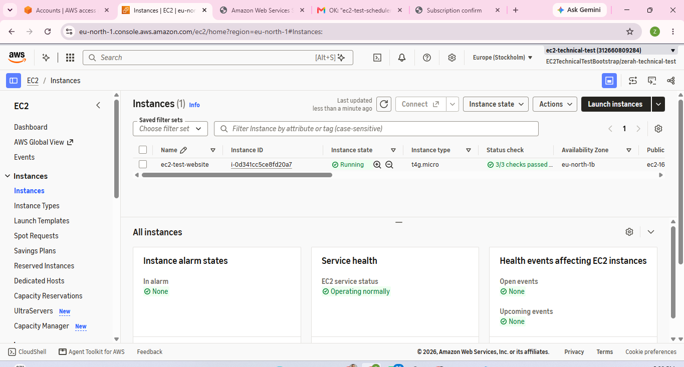

**What to notice** — The instance row shows Running, t4g.micro, 3/3 checks passed and eu-north-1b.

**Why it matters** — The machine is healthy in the alternate AZ used by the recovery drill.

**Scope** — The row supports current placement. The earlier cutover records establish how it got there.

## Retained public address and server role

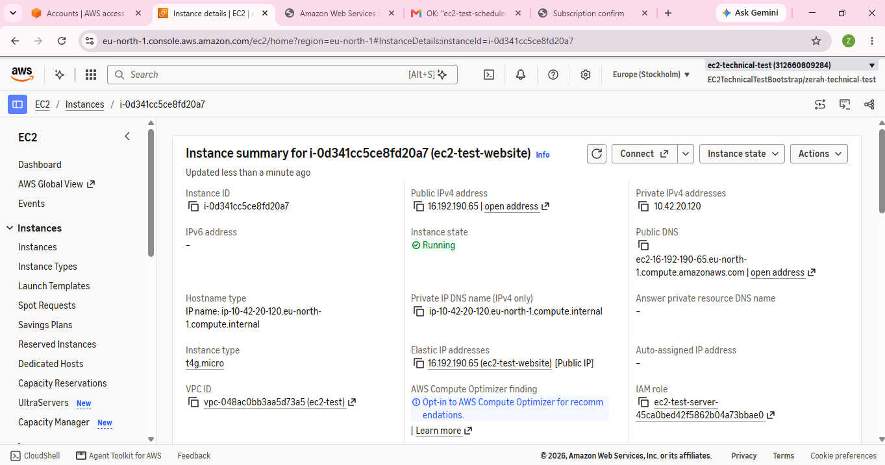

**What to notice** — The running instance has public/Elastic IP 16.192.190.65, a VPC and an IAM role.

**Why it matters** — The retained address gives visitors the same endpoint after instance replacement. The role supplies temporary server credentials.

**Scope** — An attached role is not evidence of least privilege without its policy.

## Restored server uses the recovery image

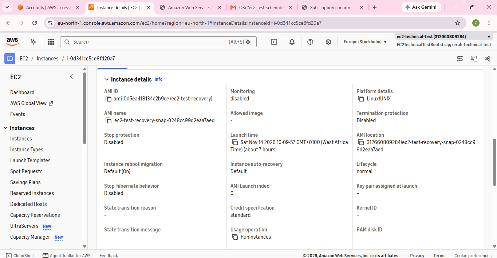

**What to notice** — The current instance identifies ami-0d5ea418134c2b9ce and the recovery snapshot in its AMI name.

**Why it matters** — The server booted from the disk image registered from the tested backup snapshot.

**Scope** — Combine this with the cutover output, AZ placement and restored hashes to establish the controlled recovery.

## Boot configuration and CPU credit mode

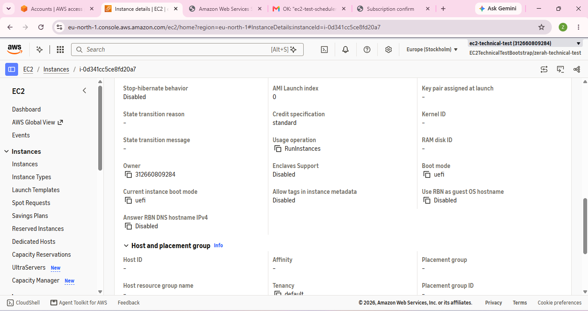

**What to notice** — UEFI boot, standard CPU credits and disabled metadata tags are displayed.

**Why it matters** — These settings describe how the ARM64 instance boots and avoids unlimited CPU-credit billing.

**Scope** — This screen does not show whether metadata tokens are required.

## Virtualization and processor count

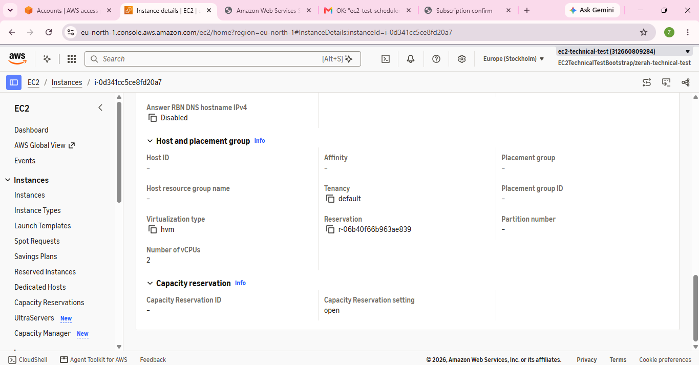

**What to notice** — HVM virtualization and two vCPUs are shown.

**Why it matters** — These describe the configured instance hardware environment.

**Scope** — Hardware details alone do not establish application readiness.

## System, instance and disk checks pass

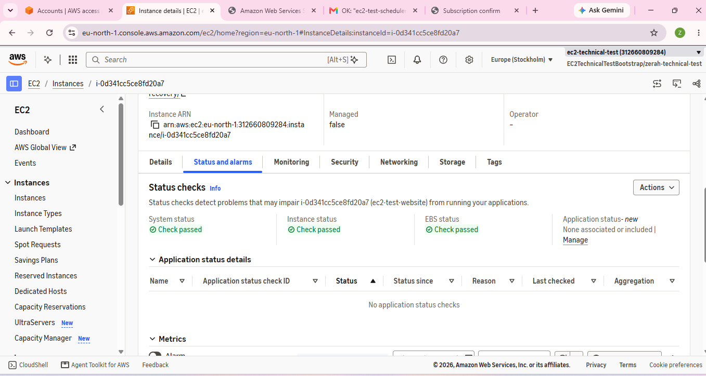

**What to notice** — System, instance and EBS status each show Check passed.

**Why it matters** — AWS reports its infrastructure, guest-instance and attached-storage checks healthy.

**Scope** — The application-status section is empty. The separate Lambda checker tests the website.

## Server IAM role and security group

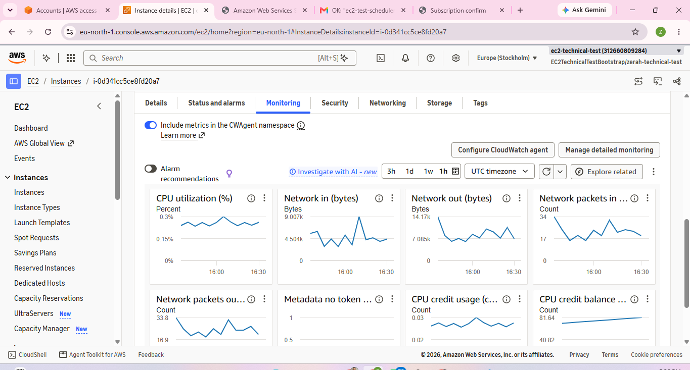

**What to notice** — The current instance is linked to its EC2 role and sg-0de6db7cee00e05f2.

**Why it matters** — This ties the access/network configuration to the same machine shown in the health evidence.

**Scope** — The server role differs from the human operator role.

## Web ports only in the displayed rules

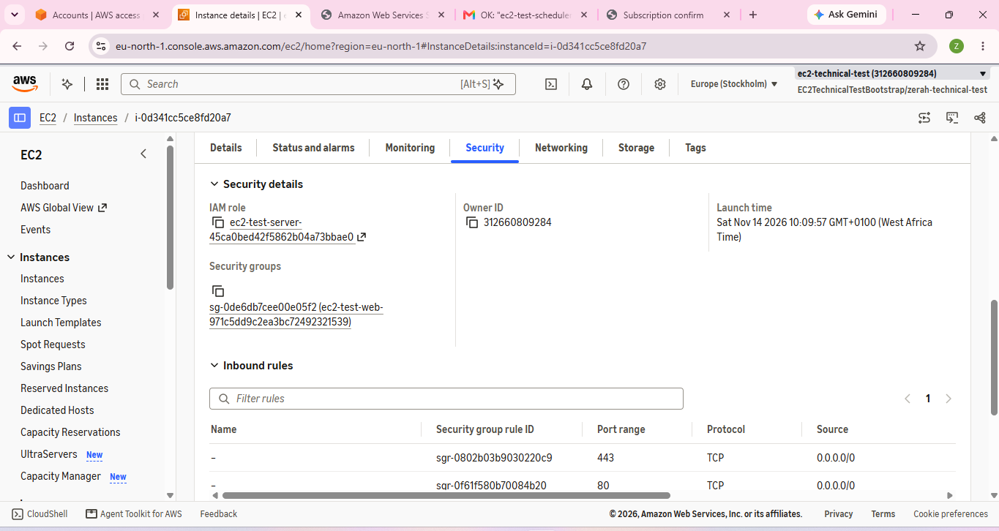

**What to notice** — Inbound and outbound tables each list TCP 80 and 443, using 0.0.0.0/0.

**Why it matters** — Visitors can reach HTTP/HTTPS. The displayed rules contain no inbound SSH rule. Outbound access is restricted by port.

**Scope** — These rules allow any IPv4 destination on those ports. Host-level SSH state is checked separately.

## Basic infrastructure measurements

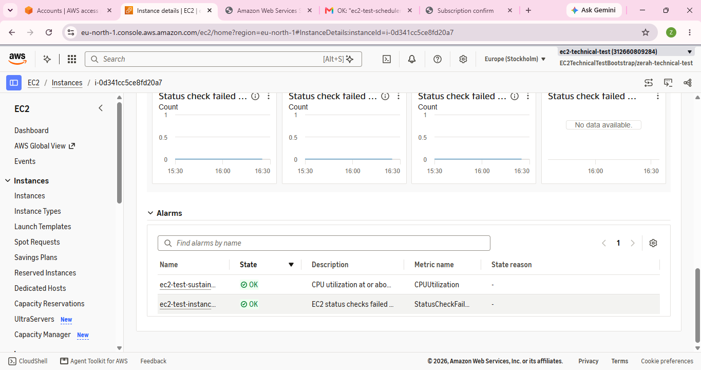

**What to notice** — CPU, network and CPU-credit charts contain observed measurements.

**Why it matters** — These graphs help an operator see whether the machine is busy and how its network and credits behave.

**Scope** — Including CWAgent metrics in the view does not prove that a CloudWatch Agent is installed.

## Status and CPU alarms healthy

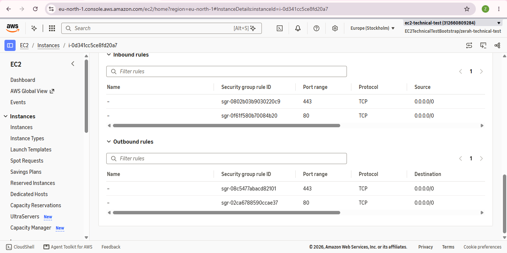

**What to notice** — The two instance-linked alarms show OK and displayed failure metrics are zero.

**Why it matters** — The infrastructure alarms are receiving measurements that do not breach their thresholds.

**Scope** — The two alarms shown are a subset of the seven project alarms.

## External content check passes

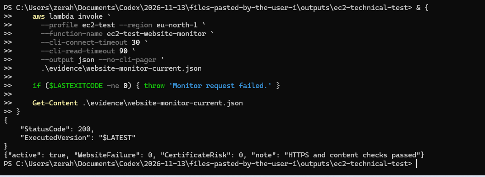

**What to notice** — Lambda returns active=true, WebsiteFailure=0, CertificateRisk=0.

**Why it matters** — The checker accepted HTTPS, the health response and the HTML/CSS hashes during operating hours.

**Scope** — These values apply to that invocation. Request success alone would not establish website health.

## Audit bucket encryption

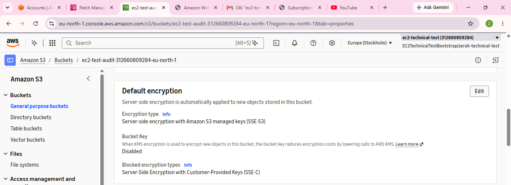

**What to notice** — The audit bucket uses server-side encryption with S3-managed keys, SSE-S3.

**Why it matters** — Stored audit objects receive server-side encryption by default.

**Scope** — The KMS bucket-key field is separate from SSE-S3 encryption. Versioning/public blocks need their own views.

## Synthetic threat finding

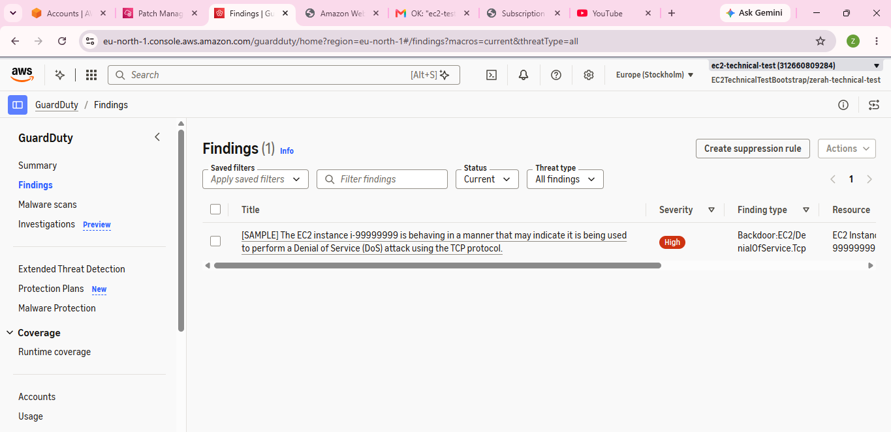

**What to notice** — GuardDuty lists a SAMPLE EC2 denial-of-service finding with High severity.

**Why it matters** — The sample exercises the finding-to-notification route in a controlled way.

**Scope** — The sample machine ID is synthetic and does not represent the running website instance.

## Foundational GuardDuty enabled

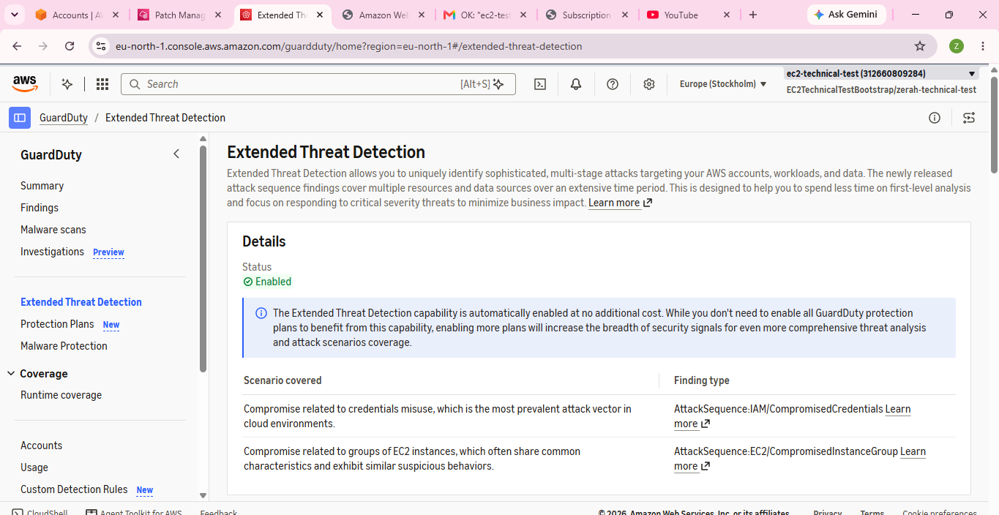

**What to notice** — Foundational GuardDuty shows Enabled for the deployment account in Stockholm.

**Why it matters** — Threat analysis is switched on for that regional detector.

**Scope** — A detector setting alone does not demonstrate detection of a real attack.

## Extended threat detection status

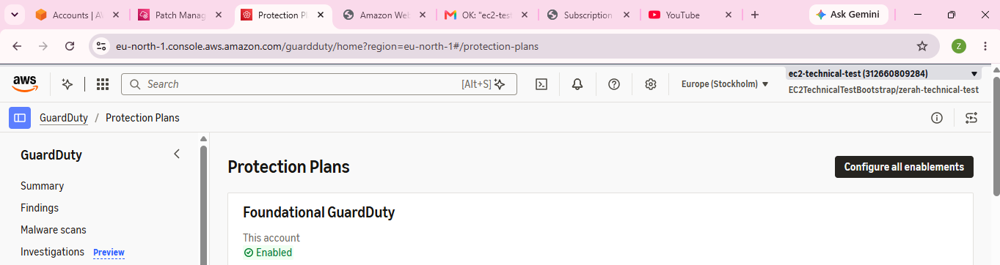

**What to notice** — Extended Threat Detection shows Enabled, with console text explaining automatic enablement.

**Why it matters** — GuardDuty can relate signals into attack-sequence findings.

**Scope** — This status is distinct from the explicitly disabled optional protection-plan list.

## Security finding routing rule

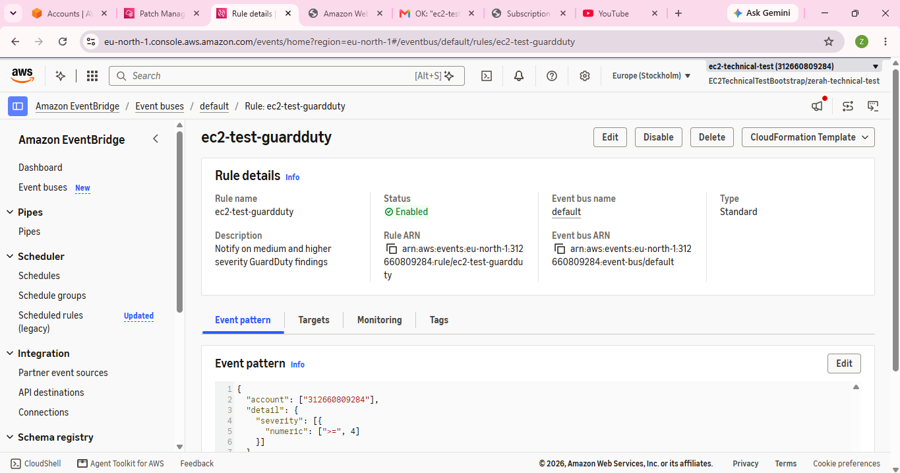

**What to notice** — ec2-test-guardduty is Enabled and the visible pattern includes severity >=4.

**Why it matters** — EventBridge selects medium-or-higher findings to send toward the configured notification target.

**Scope** — The Targets tab or API record establishes the SNS destination.

## Checker connected to EventBridge

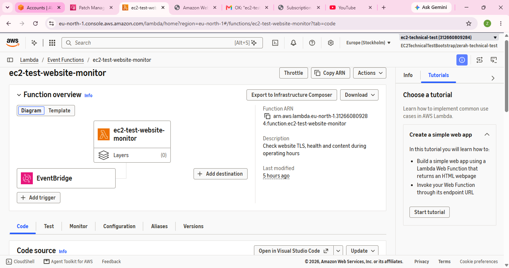

**What to notice** — Lambda overview shows an EventBridge trigger and the monitor function ARN.

**Why it matters** — An event rule is connected to the external website checker.

**Scope** — The schedule interval is recorded in the event rule settings or Terraform.

## Deployed checker source

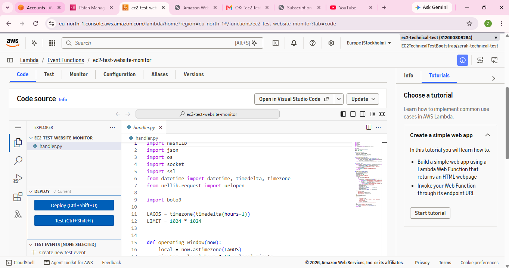

**What to notice** — handler.py is visible in the Lambda code editor.

**Why it matters** — The deployed checker source includes HTTPS, hash and operating-hours logic.

**Scope** — A code view alone does not prove a successful run. The invocation and log evidence does.

## Recurring checker executions

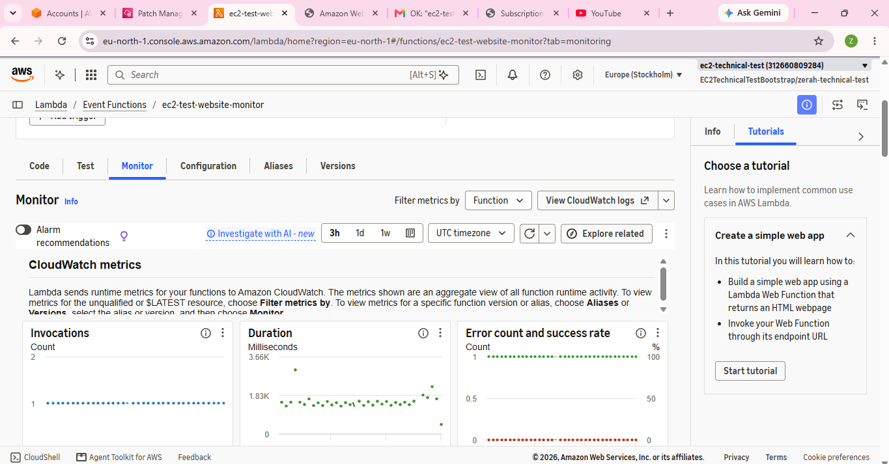

**What to notice** — Lambda graphs show recurring invocations, duration and success/error measurements.

**Why it matters** — The checker is being invoked repeatedly and completing at the Lambda runtime level.

**Scope** — A function can complete successfully while returning WebsiteFailure=1. Read the checker metrics or logs too.

## Two budget records visible

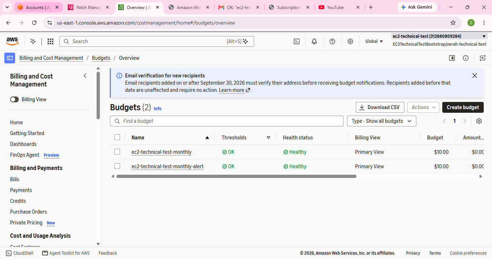

**What to notice** — The account has two $10 monthly budgets with different names.

**Why it matters** — The reviewed Terraform manages ec2-technical-test-monthly. Another similarly named budget also exists.

**Scope** — The second budget origin is unverified. Neither budget is a hard spending cap.

## Budget recipient verification gap

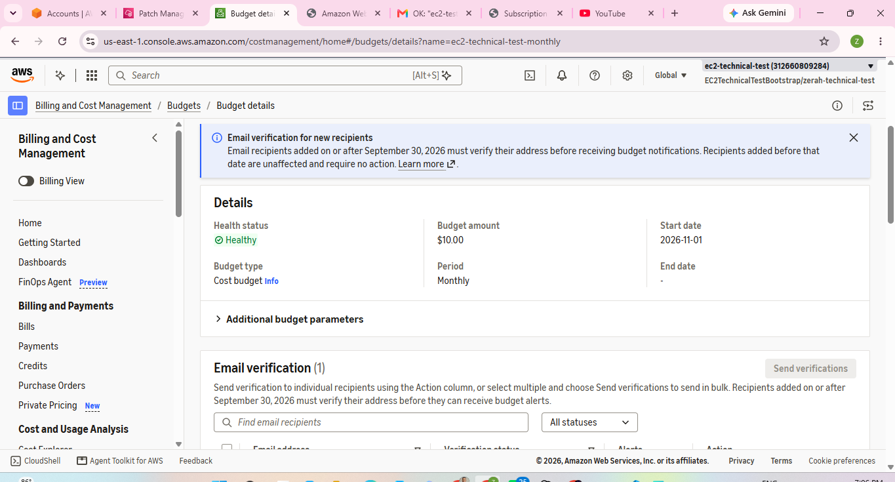

**What to notice** — The budget is $10/month and shows 0/1 email verified.

**Why it matters** — The threshold exists, but the recipient must complete AWS Budgets email verification for delivery.

**Scope** — A confirmed SNS subscription is separate from a verified Budgets recipient.

## Monthly budget and email verification

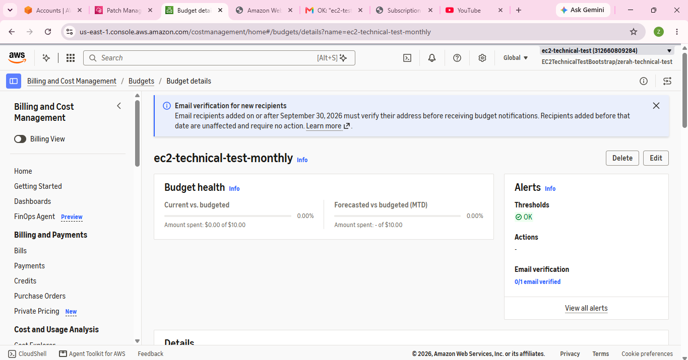

**What to notice** — The detail view shows a $10 monthly cost budget and the recipient-verification section.

**Why it matters** — This is where the budget amount and verification status can be reviewed.

**Scope** — Verify the recipient and capture the updated status before claiming budget-email delivery.

## MFA device registered for the operator

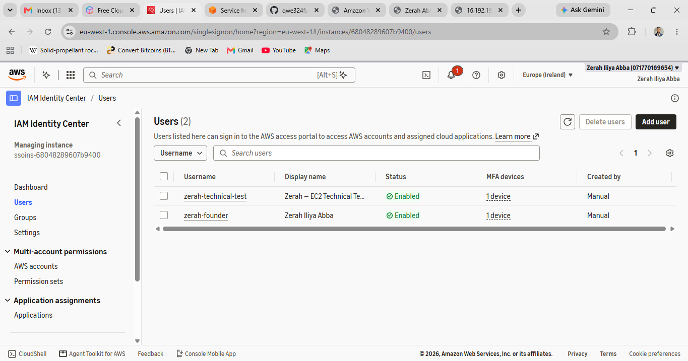

**What to notice** — Identity Center lists zerah-technical-test as Enabled with one MFA device.

**Why it matters** — The human identity has an MFA device enrolled in the central Identity Center instance.

**Scope** — Registration alone does not establish enforcement or a recent MFA challenge. This central account differs from the workload account.

## Enabled operator identity

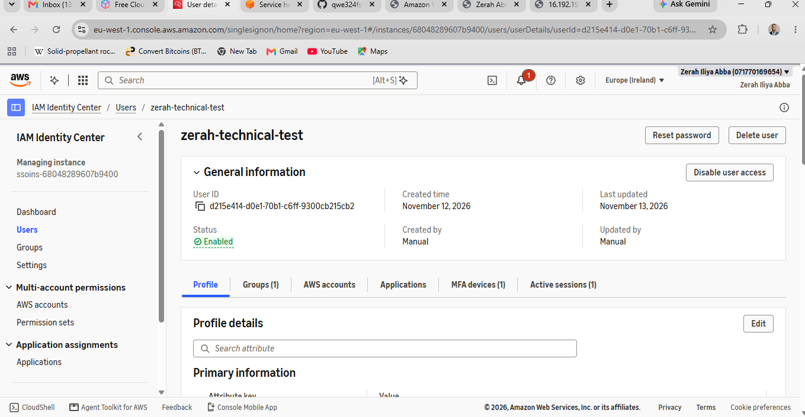

**What to notice** — The user detail shows Enabled and MFA devices (1).

**Why it matters** — This is the central identity used for the technical-test login.

**Scope** — Show the MFA policy and an actual protected login to establish enforcement.

## Two days of scheduled stop events

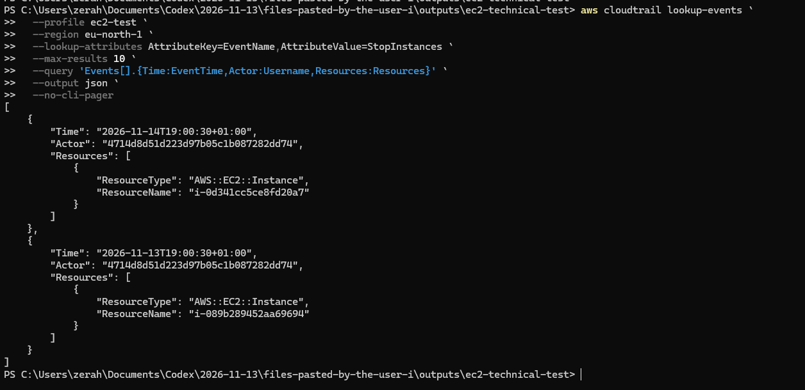

**What to notice** — CloudTrail lookup shows StopInstances at 19:00:30 Lagos on two dates, targeting the current and original machines.

**Why it matters** — The stop action followed the same daily timing even after the instance replacement.

**Scope** — The detailed event identifies the scheduler role. This list alone shows only its session identity.

## Instance stopped after 19:00

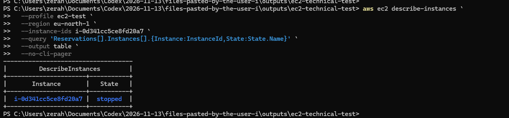

**What to notice** — The EC2 API reports the current instance Stopped.

**Why it matters** — This is the outcome expected outside operating hours.

**Scope** — The detailed CloudTrail event establishes the automated action behind this state.

## Scheduler identity behind the shutdown

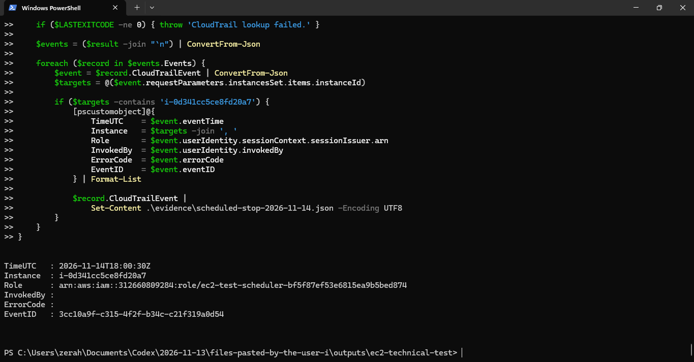

**What to notice** — The event details identify the scheduler role, current instance, 18:00:30 UTC and event ID.

**Why it matters** — 18:00 UTC equals 19:00 Lagos. This ties the automation identity to the action and machine.

**Scope** — Combine with the stopped-state capture. InvokedBy is blank, but the session issuer role identifies the caller.

## Landing page after maintenance

**What to notice** — The website is visible after the recorded OS patching work.

**Why it matters** — The service remained usable after the patch installation. Compare this with the patch-state record.

**Scope** — The browser image does not show which patches were installed.

## Health endpoint

**What to notice** — The browser shows ok at /healthz.

**Why it matters** — The health path gives a small, predictable response that the external checker can request.

**Scope** — The health path alone cannot detect every change to the landing page.

## GuardDuty message reached the inbox

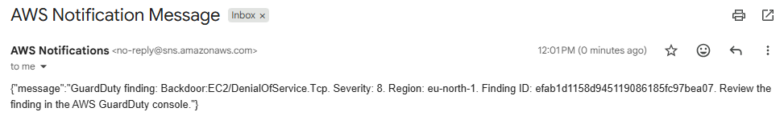

**What to notice** — The email contains the sample GuardDuty finding and severity 8.

**Why it matters** — This connects the synthetic security finding to an email delivered to the recipient.

**Scope** — Synthetic finding received in the inbox. This image is a crop of the supplied email screenshot.

## ALARM email received

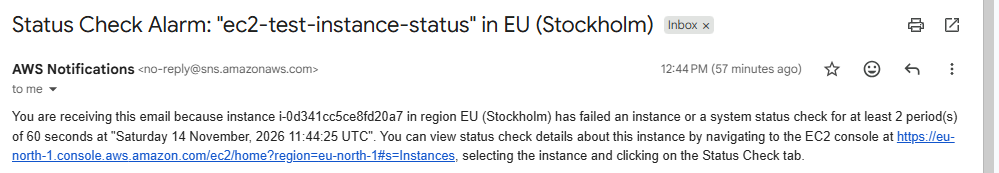

**What to notice** — The EC2 status alarm email is visible in the recipient inbox.

**Why it matters** — The notification route delivered a message when the operator requested a controlled ALARM state.

**Scope** — The generic email wording describes the threshold. The test did not cause a real status-check failure.

## Recovery email after the alarm test

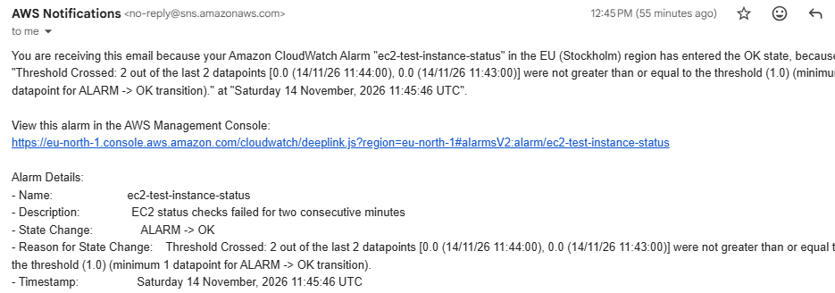

**What to notice** — The message reports ALARM to OK and healthy status-check data.

**Why it matters** — After the controlled alert test, real healthy measurements returned the alarm to OK.

**Scope** — This was a synthetic alarm-state test, not an induced EC2 hardware failure.
